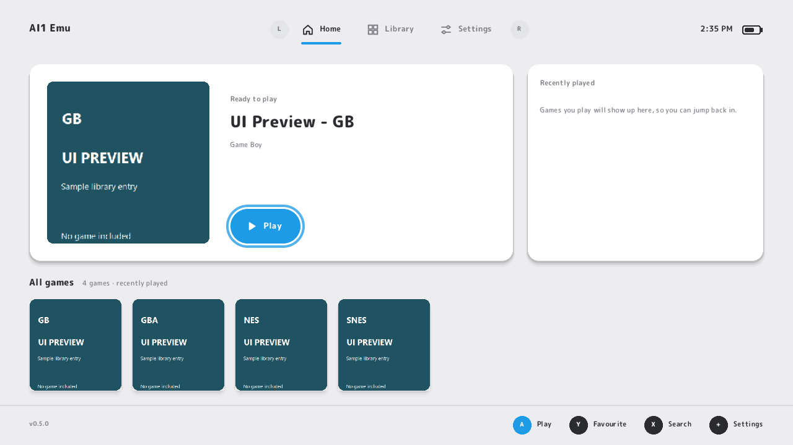
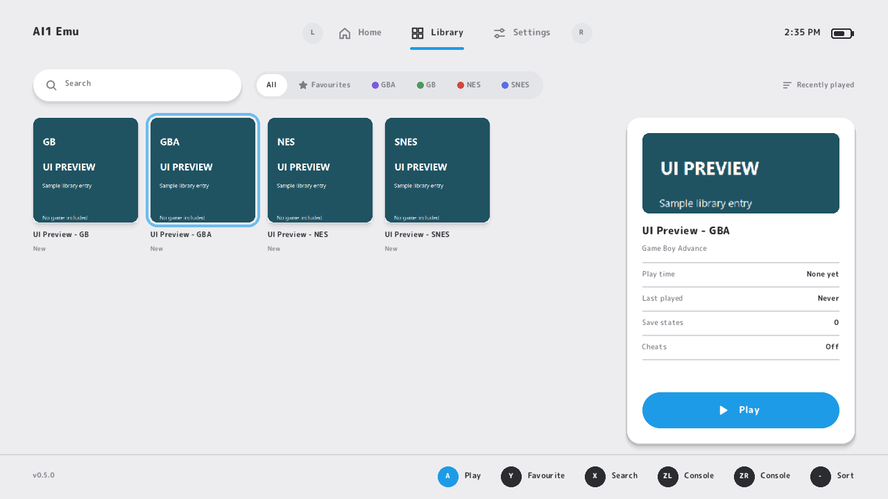
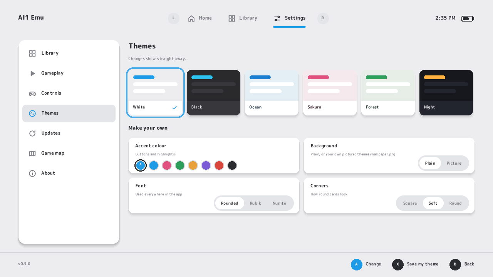
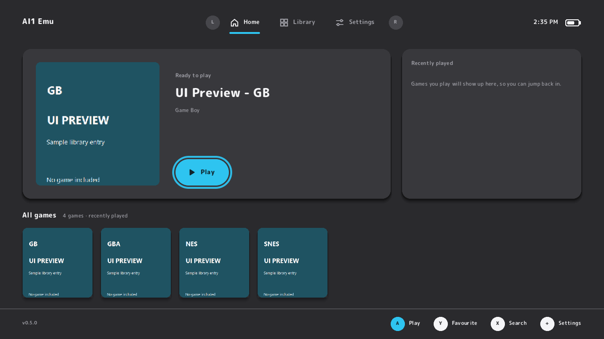
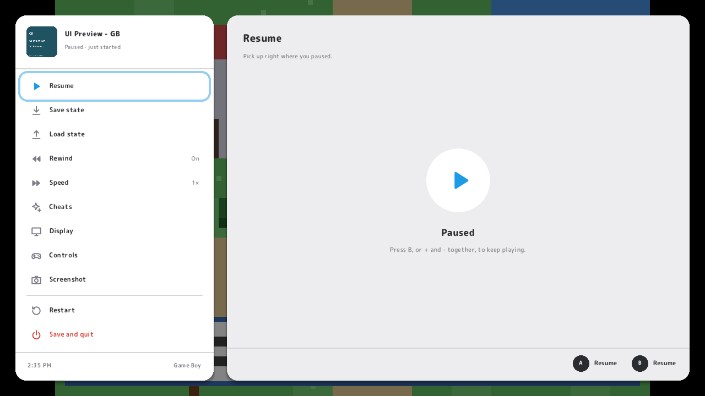
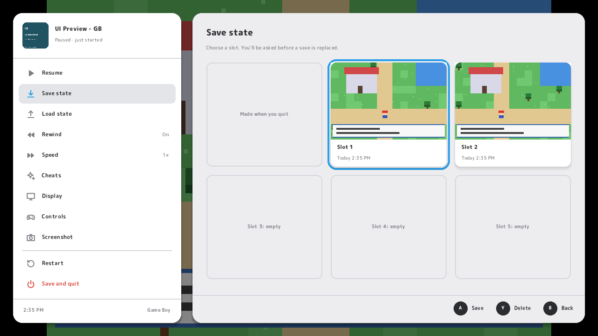
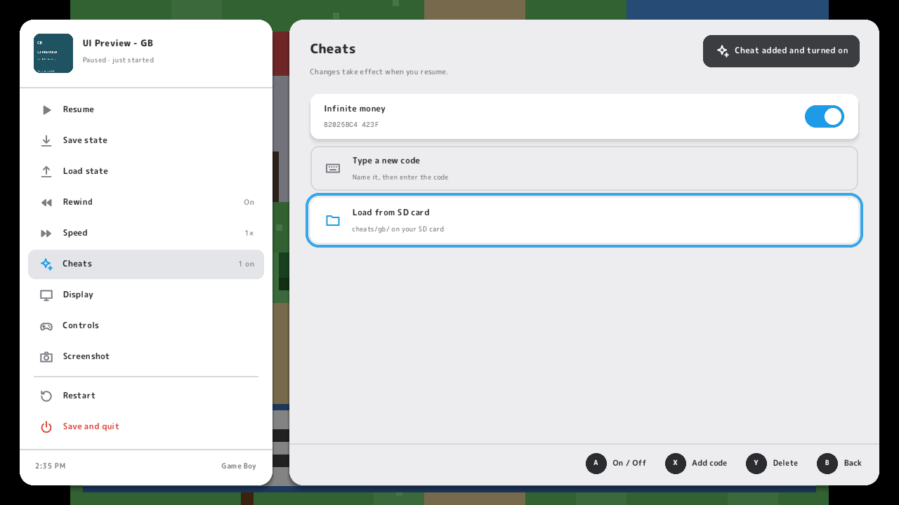

# AI1 Emu — One library. Multiple consoles. Your way to play.

A controller-and-touch Nintendo Switch homebrew frontend for your own retro game collection.

**Preview development:** These are authentic shared-renderer Windows captures with sample entries and simulated game-session callbacks. They demonstrate the interface, not Switch gameplay performance. v0.5.4 Preview includes the shared-menu cheat downloader and reliability fixes. This release still needs physical Switch regression testing.

[Download v0.5.4 Preview](https://github.com/BigBubbaLewis/AI1-Emu/releases/tag/v0.5.4-preview) · [Other downloads](https://ai1emu-updates.freegamez.workers.dev/) · [Source repository](https://github.com/BigBubbaLewis/AI1-Emu) · [Issue tracker](https://github.com/BigBubbaLewis/AI1-Emu/issues)

## A library that feels like yours

Browse systems in one library, find a game, and make the interface your own. The redesigned Home, Library and Settings screens share the same SDL2 renderer with the desktop preview.



*Actual v0.5.0 Windows UI preview. Four explicitly labeled sample entries demonstrate the layout and custom-cover path. They contain no games. Battery and game-session information are preview fixtures.*



*Actual shared-renderer library capture with sample entries, not a compatibility demonstration.*

## What is ready to show

The isolated desktop build demonstrates the redesigned Home and Library, search/filter/sort UI, custom covers, theme presets, accent/font choices, and controller-reference screens. White and black interfaces are shown below.




The game-session UI includes quick-menu, cheat-management and save-slot pages. In this preview, core callbacks and the background scene are simulated. These captures do not verify cheats, rewind, autosave or save-state compatibility with a Switch emulator core.

<details><summary>Preview the game-session interface</summary>





</details>

The current Switch code wires the in-game menu into mGBA, NES, SNES, Sega, DS and N64 runners. Physical regression tests remain necessary. The Controls page displays mappings and button activity; it is not a gameplay-binding editor.

## Current downloads and installation

Use the download hub to select an available build. Stable, preview and test channels are distinct. The v0.5 UI shown here is preview development; an older stable package may have an earlier interface. Back up your saves before trying a preview.

For an existing complete package, extract it on a computer and merge its `switch` folder into the SD root. Preserve existing saves and artwork. The main executable belongs at

```text
SD:/switch/ai1emu/AI1Emu.nro
```

Launch through Homebrew Menu in full-memory application mode on an Atmosphère-enabled original Switch or Switch Lite. Add your legally obtained, uncompressed ROMs under `switch/ai1emu/roms/<console>/`. Install all companion NROs in `switch/ai1emu/cores/`. The directory has no extra enclosing package folder.

| Console folder | Core | Accepted formats | Current evidence |
| --- | --- | --- | --- |
| `gba` | mGBA | `.gba` | Owner-reported gameplay in earlier builds |
| `gb`, `gbc` | mGBA | `.gb`, `.gbc` | Integrated, candidate regression tests required |
| `nes` | FCEUmm | `.nes` | Integrated, candidate hardware tests required |
| `snes` | Snes9x | `.sfc`, `.smc` | Integrated, some chips need user-supplied data |
| `genesis` | Genesis Plus GX | `.md`, `.gen`, `.smd`, supported `.bin` | Cartridge support, candidate hardware tests required |
| `sms`, `gg` | Genesis Plus GX | `.sms`, `.gg` | Integrated, candidate hardware tests required |
| `nds` | melonDS | `.nds` | Owner-reported gameplay in earlier builds, audio issues reported |
| `dsi` | melonDS | `.dsi`, DSi-only `.nds` | Experimental, own firmware/NAND required, states unsupported |
| `n64` | Mupen64Plus-Next | `.z64`, `.v64`, `.n64` | Experimental, per-game hardware performance unverified |

3DS/2DS launch through a separate experimental Dekopon companion with its own menu and save behavior. The AI1 in-game menu and automatic return are not integrated there. Owner reports include slow or choppy audio. PS1 and PSP are not integrated. CPU boost is optional and off by default. Integration does not establish full-speed performance for every game.

## Your artwork and saves

Custom covers use `covers/<console>/<ROM basename>.png` or `.jpg`. Match every character in the filename, including accents and version labels. The Windows DBI artwork tool can prepare available covers from its catalog. It is unsigned and may trigger Windows warnings. Built-in Switch cover downloading is not implemented in this snapshot.

Games and cached covers can be used offline. Updating the app or downloading covers requires a connection. Normal saves and states belong in the app's data folder. Back up saves before replacing cores, changing ROM paths or trying a new candidate. Test state support per core and release.

## Build, contribute and test

The project uses C++17, SDL2, libnx and devkitA64. Core source, project adaptations and third-party notices are included in the repository. Public main and active local development can differ: use the exact corresponding source of a binary release. Release-readiness work includes host tests and fresh Switch builds; no new hardware results are claimed.

Contributions should include reproducible steps, source/build version and separate host versus physical Switch results. No standardized game FPS benchmark results are available yet. Reports should state the exact device, clocks, scene, run duration and measurement method.

## Credits and license

Thanks to mGBA, melonDS, FCEUmm, Snes9x, Genesis Plus GX, Mupen64Plus-Next, Libretro, devkitPro, libnx, SDL2, zlib and the font projects. Preserve their source and notices when redistributing.

AI1-owned frontend code has scoped MIT terms. Emulator cores and dependencies retain separate terms, including MPL, GPL and noncommercial conditions. Branding and metadata are separately licensed. A release must include the exact corresponding source and notices for its binaries.

Supply your own legally obtained games and firmware. The package must exclude commercial ROMs, proprietary firmware, console keys, credentials and unlicensed artwork collections. AI1 Emu is an independent homebrew project unaffiliated with Nintendo or the original publishers.
