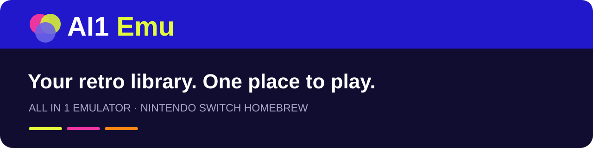
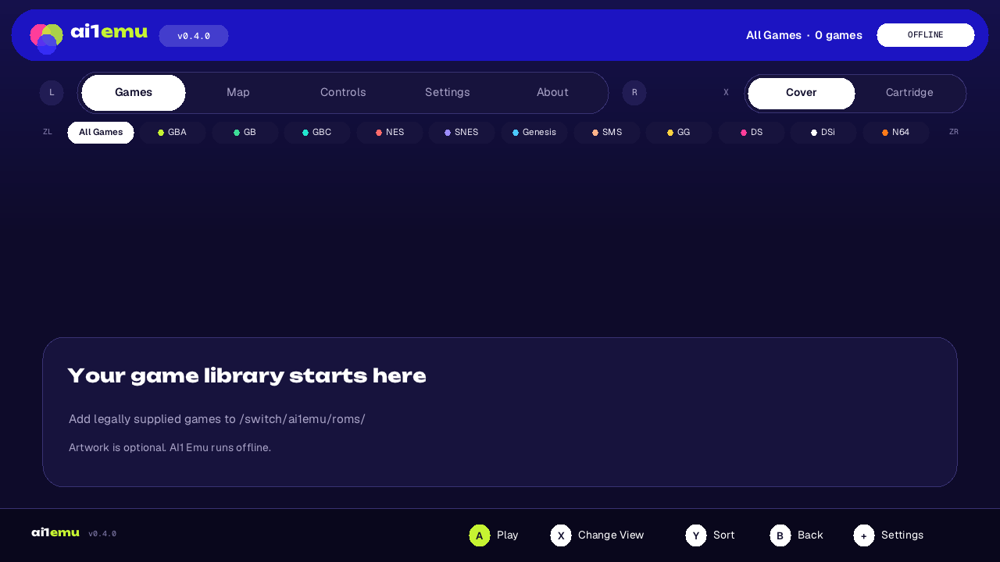
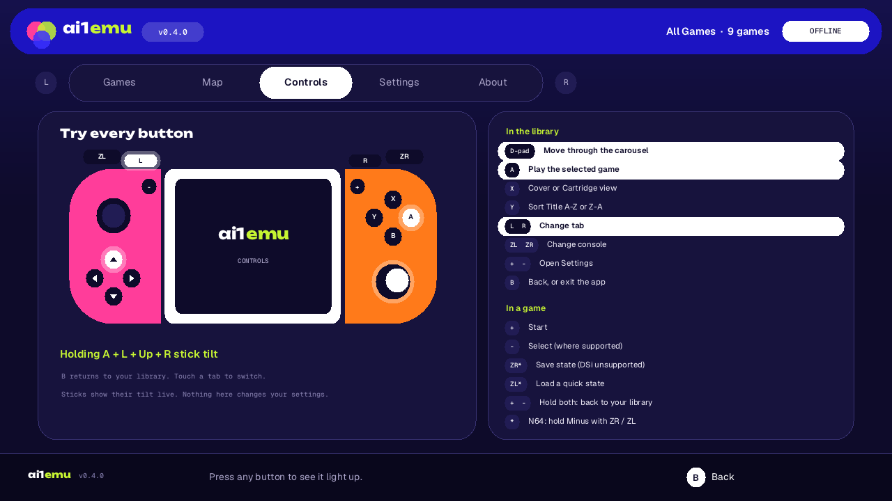
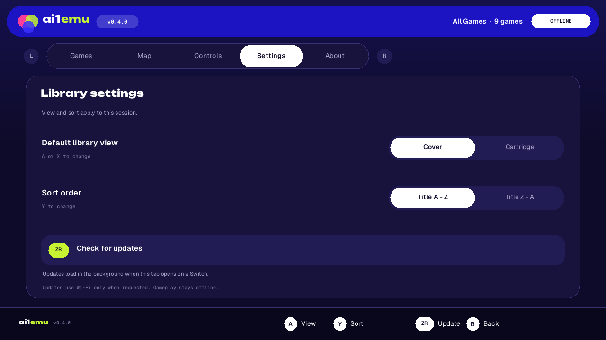

<p align="center"></p>

<p align="center"><strong>Your retro library. One place to play.</strong><br>A controller-and-touch homebrew frontend for Nintendo Switch.</p>

<p align="center"><a href="https://ai1emu-updates.freegamez.workers.dev/">Downloads</a> · <a href="#install">Install</a> · <a href="#systems">Systems</a> · <a href="CONTRIBUTING.md">Contribute</a></p>

<p align="center">  </p>

AI1 Emu brings a game carousel, console categories, box-cover and cartridge views, and touchscreen navigation to your retro collection. Gameplay works offline. Optional Windows artwork tools and in-app updates help keep your library ready to play.

## See the interface



<details><summary>Controls and settings</summary>




</details>

These captures come from the Windows preview using the app's shared SDL2 renderer. The library shows the first-run empty state. The desktop preview does not emulate games.

## Download

| Channel | Download | Status |
| --- | --- | --- |
| Stable 0.3.5 | [Complete Switch package](https://ai1emu-updates.freegamez.workers.dev/releases/0.3.5/AI1-Emu-v0.3.5-Switch-Package.zip) | Existing multi-console release |
| UI preview 0.4.0 | [Complete Switch package](https://ai1emu-updates.freegamez.workers.dev/releases/0.4.0/AI1-Emu-v0.4.0-Switch-Package.zip) | Five-tab interface, compiled and host-tested, physical Switch validation pending |
| Source | [Published v0.4.0 source archive](https://ai1emu-updates.freegamez.workers.dev/source/0.4.0/AI1-Emu-v0.4.0-Corresponding-Source.tar.gz) | App, cores, notices, artwork tools and update service |

Use the complete package for a fresh installation. The standard in-app update channel remains on 0.3.5. Downloads are currently hosted on Cloudflare.

## Install

Requires an original Switch or homebrew-enabled Switch Lite running Atmosphère, with Homebrew Menu available. Use full-memory application mode for the multi-console cores.

1. Download a complete package and extract it on your computer.
2. Merge its `switch` folder into the SD root. Preserve existing ROMs, saves and custom artwork.
3. Put your legally obtained, uncompressed game backups in the matching console folder under `switch/ai1emu/roms/`.
4. Launch AI1 Emu through Homebrew Menu in application mode.

```text
SD:/switch/ai1emu/
├── AI1Emu.nro
├── cores/
├── roms/
│   ├── gba/   gb/   gbc/   nes/   snes/
│   ├── genesis/   sms/   gg/
│   └── nds/   dsi/   n64/
├── covers/
├── artwork-cache/
├── saves/
└── system/
```

The app creates console folders at startup. The package's `PC-tools` folder is for Windows. Run the self-contained DBI cover CMD with DBI's MTP responder open to prepare artwork. Cover availability varies by game and filename. Custom images go under `covers/<console>/` with the same basename as the ROM, including accents and version numbers.

## Systems

These systems have emulator integrations. Compatibility and speed depend on the game and core.

| System | Core | ROM extensions | Status / requirements |
| --- | --- | --- | --- |
| Game Boy Advance | mGBA | `.gba` | Owner-reported gameplay on an original Switch |
| Game Boy / Game Boy Color | mGBA | `.gb`, `.gbc` | Color-capable GB headers detected |
| NES | FCEUmm | `.nes` | Standard cartridge games |
| SNES | Snes9x | `.sfc`, `.smc` | Some enhancement-chip games need user-supplied data |
| Genesis / Mega Drive | Genesis Plus GX | `.md`, `.gen`, `.smd`, supported `.bin` | Cartridge systems |
| Master System / Game Gear | Genesis Plus GX | `.sms`, `.gg` | Cartridge systems |
| Nintendo DS | melonDS | `.nds` | Owner-reported gameplay, game-specific audio/performance issues remain |
| Nintendo DSi | melonDS | `.dsi`, DSi-only `.nds` | Experimental, own firmware/NAND required, states unsupported |
| Nintendo 64 | Mupen64Plus-Next | `.z64`, `.v64`, `.n64` | Experimental, hardware performance unverified |

3DS/2DS, PS1 and PSP remain research topics. See [system documentation](docs/V0.3-SUPPORT.md), [N64 notes](docs/V0.3.3-N64.md) and [v0.4.0 validation](docs/V0.4.0-INTEGRATION.md) for firmware and integration details. Earlier version notes are historical records.

## Controls and saves

| Action | Library control |
| --- | --- |
| Navigate | D-pad / left stick, or touch and drag |
| Play | A, or tap the selected game |
| Change cover / cartridge view | X |
| Sort | Y |
| Change tab | L / R |
| Change console | ZL / ZR |
| Settings | Plus / Minus |
| Back | B |

In-game, hold Plus and Minus to return to the library. ZR saves a state and ZL loads it where supported. N64 uses Minus+ZR and Minus+ZL. DS provides side-by-side, stacked and focused layouts, bottom-screen touch and docked virtual touch.

Normal saves and states live in the app's data folder, separated by console and game. Back up `saves/` before changing cores or moving ROM paths. State compatibility across core revisions is not guaranteed.

## Build and contribute

The frontend uses C++17, SDL2, libnx and devkitA64. Emulator sources and project build adaptations are included under `vendor/`. The recorded build used devkitA64 GCC 16.1.0 and SDL2 2.28.5.

From a configured devkitPro MSYS2 environment with Switch development packages, SDL2, curl, zlib and CMake installed, set `DEVKITPRO` to your SDK installation and run

```sh
bash scripts/build-multi-switch.sh
```

The main output is `AI1Emu.nro`. Companion NROs are generated under `build/switch/cores/`. Read [collaboration notes](COLLABORATING.md) and [contribution guidance](CONTRIBUTING.md) for the frontend, Windows preview, tests and update service.

A prior v0.4.0 build and nine native host checks passed. Repository preparation has not recompiled the app or verified every system on hardware. No overclocking is configured.

## Credits and licensing

AI1-owned frontend and integration code uses the scoped MIT terms in [LICENSE](LICENSE). Emulator cores and third-party components retain their own terms. The full collection is not uniformly MIT licensed. Snes9x and Genesis Plus GX include noncommercial restrictions. Preserve upstream notices and review applicable terms before redistributing a package. Branding and third-party metadata have separate terms.

Thanks to the mGBA, melonDS, FCEUmm, Snes9x, Genesis Plus GX, Mupen64Plus-Next, Libretro, devkitPro, libnx, SDL2 and font communities. See [licenses](licenses/) and upstream source trees for attribution.

Supply your own legally obtained games and required firmware. Downloads exclude commercial ROMs, proprietary firmware, console keys and commercial cover collections. AI1 Emu is an independent homebrew project, unaffiliated with Nintendo or the original game publishers.
